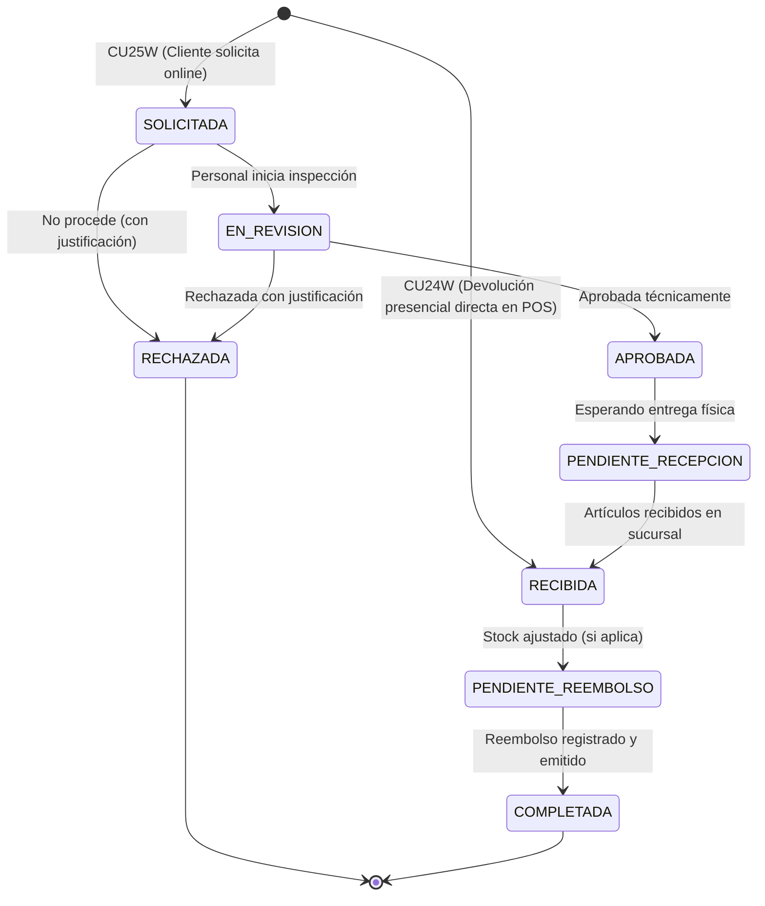

# Auditoría Técnica y Plan de Implementación: Devoluciones Online (Iteración 3)

**Fecha:** 2026-10-31  
**Autor:** Antigravity  
**Casos de Uso:** CU24W (Gestionar Devoluciones) y CU25W (Solicitar Devolución)  
**Alcance:** Exclusivamente Online (FastAPI + PostgreSQL como fuente de verdad única; sin encolamiento offline)

---

## 1. Arquitectura Modular del Repositorio

El proyecto cuenta con una arquitectura desacoplada y modular:
* **Backend (`backend/app/modules/`)**: Organizado en 10 dominios funcionales bajo el patrón de 3 capas (`routes` → `services` → `repos`):
  * `auth`: Seguridad, tokens JWT autoritativos, RBAC y auditoría.
  * `saas`: Gestión de empresas (tenants), planes Básico/Profesional y vigencias.
  * `catalogo`: Productos, variantes talla/color, categorías y promociones.
  * `inventario`: Existencias por sucursal (`t_inventario`), movimientos (`t_movimiento_inventario`), proveedores y lotes.
  * `ecommerce`: Carrito de compras y pasarela de pago (PayPal Sandbox).
  * `reservas`: Apartado de prendas en tienda y atención en mostrador.
  * `pos`: Terminal Punto de Venta, sesiones de caja (`t_caja_sesion`) y ventas en mostrador.
  * `pedidos`: Historial de pedidos (`t_pedido`), órdenes de clientes, métricas e informes.
  * `ia`: Asistente virtual y triaje inteligente.
  * `admin`: Sucursales, ciudades, bitácora y notificaciones.
* **Frontend (`frontend/src/app/modules/`)**: Estructura espejo en Angular 19 PWA con 10 dominios de servicios, fachadas retrocompatibles en `frontend/src/app/services/` y path mappings en `tsconfig.json`.

---

## 2. Auditoría del Esquema PostgreSQL (`comercio`)

Tras la inspección en modo solo lectura sobre el clúster PostgreSQL de producción (`obras` en `147.15.29.190:5433`), se identificó:

### 2.1 Tablas Existentes de Devoluciones
Las tablas de devoluciones **ya existen** en la base de datos (con 0 registros actualmente):
1. **`comercio.t_devolucion`**:
   * `id_devolucion` (integer PK, auto-incremental)
   * `id_venta` (integer, FK → `t_venta.id_venta`)
   * `id_usuario` (integer, FK → `t_usuario.id_usuario`)
   * `fecha_devolucion` (timestamp without time zone, default `CURRENT_TIMESTAMP`)
   * `motivo` (character varying)
   * `monto_reembolso` (numeric)
   * `estado` (character varying)
2. **`comercio.t_detalle_devolucion`**:
   * `id_detalle_devolucion` (integer PK, auto-incremental)
   * `id_devolucion` (integer, FK → `t_devolucion.id_devolucion`)
   * `id_detalle_venta` (integer, FK → `t_detalle_venta.id_detalle_venta`)
   * `cantidad` (integer)

### 2.2 Tablas Relacionadas de Ventas, Inventario y Pagos
* **`t_venta`**: Registro maestro de venta (online y física). Columnas clave: `id_venta`, `id_cliente` (FK a `t_cliente`), `id_sucursal` (FK a `t_sucursal`), `id_empresa` (tenant), `numero_venta` (código visible ej. `VTA-20260913-60799`), `tipo_venta` (`'ONLINE'`, `'PRESENCIAL'`), `subtotal`, `descuento`, `total`, `estado` (`'COMPLETADA'`, `'PAGADO'`, `'PENDIENTE_PAGO'`).
* **`t_detalle_venta`**: Ítems vendidos. Columnas clave: `id_detalle_venta`, `id_venta`, `id_variante` (FK a `t_producto_talla_color`), `cantidad`, `precio_unitario`, `descuento`, `subtotal`.
* **`t_inventario`**: Stock por sucursal y variante: `id_sucursal`, `id_variante`, `stock_actual`, `stock_reservado`, `stock_disponible`, `stock_minimo`.
* **`t_movimiento_inventario`**: Auditoría de movimientos de stock: `id_inventario`, `id_usuario`, `tipo_movimiento` (`'ENTRADA'`, `'SALIDA'`, `'AJUSTE'`, etc.), `cantidad`, `stock_anterior`, `stock_nuevo`, `motivo`, `fecha_movimiento`.
* **`t_pago`**: Pagos de ventas: `id_venta`, `id_metodo_pago`, `codigo_transaccion`, `monto`, `estado`, `referencia_externa`.

---

## 3. Discrepancias Identificadas entre Propuesta y Código/BD Real

1. **Campos Faltantes en `t_devolucion`**:
   * Falta un código de seguimiento alfanumérico para el cliente (ej. `DEV-20261031-ABC12`).
   * Falta `tipo_devolucion` (`'SOLICITUD_CLIENTE'` vs `'PRESENCIAL_MOSTRADOR'`).
   * Falta `descripcion_cliente` y `evidencia_url` (para adjuntar justificaciones detalladas o fotos).
   * Faltan campos de resolución: `id_usuario_revisor`, `fecha_resolucion`, `observaciones_resolucion`.
   * Faltan campos de control de reembolso: `metodo_reembolso`, `referencia_reembolso`, `fecha_reembolso`.
2. **Campos Faltantes en `t_detalle_devolucion`**:
   * Falta registrar la **condición física del artículo recibido**: `'REVENDIBLE'` (apto para volver a stock vendible) vs `'DEFECTUOSO'` / `'NO_REVENDIBLE'` (retenido/merma, sin inflar stock disponible).
   * Falta `monto_unitario` y `subtotal` devuelto para trazabilidad monetaria exacta.
   * Falta `estado_item` (`'SOLICITADO'`, `'RECIBIDO'`, `'RECHAZADO'`).
3. **Ausencia de Pasarela de Reembolso Automático**:
   * `paypal_service.py` solo implementa `crear_orden_paypal` y `capturar_orden_paypal`. No existe integración con API de reembolsos (`/v2/payments/captures/{id}/refund`), ni para pagos en efectivo de POS.
   * **Solución de negocio:** Implementar inicialmente el registro, validación y control riguroso del reembolso con sus estados (`PENDIENTE_REEMBOLSO` → `REEMBOLSADO`), método y referencia de comprobante, sin simular falsas pasarelas externas.
4. **Permisos RBAC Granulares Inexistentes**:
   * En `t_permiso` solo existen `ventas.*` e `inventario.*`. No hay permisos para `devoluciones.*`.
   * Se requiere sembrar permisos granulares:
     * `devoluciones.ver`: Consultar solicitudes e historial.
     * `devoluciones.solicitar`: Solicitar devolución (CLIENTE).
     * `devoluciones.crear_presencial`: Registrar devolución en mostrador (CAJERO / ENCARGADO).
     * `devoluciones.revisar`: Inspeccionar y dictaminar solicitudes.
     * `devoluciones.aprobar_rechazar`: Aprobar o denegar formalmente.
     * `devoluciones.recibir`: Registrar recepción física de prendas y ajustar inventario según condición.
     * `devoluciones.reembolsar`: Registrar y liquidar el reembolso económico.
5. **Aislamiento Multitenant y Validación de Ventas**:
   * Las solicitudes deben verificar que la venta pertenezca estrictamente a la empresa (`id_empresa`) y al cliente (`id_cliente` / `id_usuario`) en sesión.
   * Ventas no sincronizadas o en conciliación (`t_sync_operacion` con `status = 'reconciliation_required'` o `pending`) **no son elegibles** para devolución hasta su resolución definitiva en el servidor.

---

## 4. Máquina de Estados y Reglas de Transición

Catálogo unificado de estados para `t_devolucion.estado`:

---

## 5. Plan de Cambios y Entregables

1. **Migración SQL (`backend/migrations/005_iter3_devoluciones.up.sql` y `.down.sql`)**:
   * Extensión no destructiva de `t_devolucion` y `t_detalle_devolucion` mediante `ADD COLUMN IF NOT EXISTS`.
   * Sembrado de permisos `devoluciones.*` en `t_permiso` y asociación en `t_rol_permiso` según roles.
2. **Capa Backend (`backend/app/modules/pedidos/`)**:
   * `repos/devoluciones_repos.py`: Consultas atómicas con bloqueos `FOR UPDATE` para cálculo de cantidades elegibles, verificación de pertenencia, inserción transaccional, ajuste condicional de stock (`t_inventario` + `t_movimiento_inventario`) y control de reembolsos.
   * `services/devoluciones_services.py`: Validación de reglas de negocio, cálculo financiero proporcional (descuentos por prenda), control de concurrencia y validación de permisos de sucursal/tenant.
   * `routes/devoluciones_routes.py`: Endpoints REST seguros para cliente y personal administrativo.
3. **Capa Frontend (`frontend/src/app/`)**:
   * `modules/pedidos/services/devoluciones.ts` y fachada `services/devoluciones.ts`.
   * **CU25W (Cliente)**:
     * Botón "Solicitar Devolución" en el detalle de `mis-pedidos` para pedidos elegibles (`PAGADO` / `ENTREGADO`).
     * Modal interactivo de selección de prendas, cantidades máximas elegibles, motivo y descripción.
     * Nueva pestaña/sección "Mis Devoluciones" para seguimiento de estado, notas y resoluciones.
   * **CU24W (Personal)**:
     * Módulo `pages/devoluciones/` accesible desde el panel administrativo (menú "Ventas → Devoluciones").
     * Bandeja con filtros por estado, sucursal, cliente, rango de fechas y paginación.
     * Registro de devolución presencial rápida buscando por número de venta.
     * Modal de inspección física: selección de prendas recibidas indicando condición (`Revendible` vs `Defectuoso`).
     * Modal de liquidación de reembolso: método, referencia y comprobante.
4. **Pruebas Automatizadas y Evidencias**:
   * Suite de pruebas unitarias y de integración en `tests/test_devoluciones_iter3.py` sobre PostgreSQL aislado (`LocalPostgres`).
   * Verificación de compilación limpia en Angular (`npm run build`).
5. **Documentación Final**:
   * `docs/DEVOLUCIONES_IMPLEMENTACION.md` y actualización en `docs/AGENT_CHANGES.md`.

