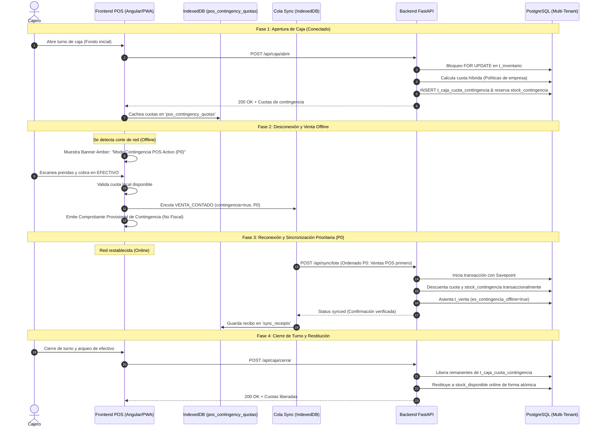

# Arquitectura de Contingencia Offline para POS — AuroraStore (Iteración 6)

## 1. Visión General y Justificación

En tiendas de moda físicas bajo modelo SaaS multitenant, las interrupciones temporales de conectividad a Internet no deben paralizar las ventas presenciales en mostrador. Sin embargo, habilitar transacciones offline sin control expone al negocio a riesgos de sobreventa simultánea frente al StoreFront de comercio electrónico.

La solución arquitectónica implementada en la **Iteración 6 (Migración 008)** garantiza:
1. **Atención presencial continua:** el POS puede operar y emitir comprobantes provisionales sin red.
2. **Stock de contingencia blindado:** las unidades apartadas para el POS quedan reservadas y no compiten ni se venden en la tienda online.
3. **Distribución transaccional multi-terminal:** dos o más cajas en la misma sucursal no pueden recibir ni vender la misma unidad física.
4. **Seguridad de cobro:** las ventas offline se restringen estrictamente a **EFECTIVO** (los pagos por QR, pasarelas bancarias y PayPal se deshabilitan por requerir confirmación remota).
5. **Prioridad P0 en sincronización:** las ventas físicas en mostrador se liquidan prioritariamente al recuperar la red.
6. **No anulación de compras confirmadas:** si surge una sobreventa real por concurrencia extrema, no se cancela una compra online confirmada; se asienta la venta física y se emite una incidencia (`t_incidencia_sobreventa`) para conciliación gerencial.
7. **Restitución limpia:** al cerrar turno en caja, las cuotas no vendidas regresan de forma atómica al stock disponible online.
8. **Identificación provisional:** los comprobantes emitidos sin conexión están marcados explícitamente como provisionales de contingencia, sin confundirse con facturas fiscales formales.

---

## 2. Diagrama de Flujo y Ciclo de Vida



---

## 3. Modelo de Datos y Migración 008

### 3.1. Extensión de `empresa`
- `politica_contingencia_pos` (JSONB):
  ```json
  {
    "habilitado": true,
    "modo": "PORCENTAJE",
    "porcentaje_defecto": 15.0,
    "cantidad_fija_defecto": 2,
    "minimo_unidades": 1,
    "maximo_unidades": 10,
    "permitir_sobreventa_con_incidencia": true,
    "solo_efectivo_offline": true
  }
  ```

### 3.2. Extensión de `t_inventario`
- `stock_contingencia` (INTEGER DEFAULT 0 CHECK >= 0): unidades físicas apartadas exclusivamente para contingencia offline.
- `cuota_manual_contingencia` (INTEGER NULL): sobreescritura manual por variante si la boutique así lo define.
- Ecuación de consistencia del balance físico:
  $$\text{stock\_actual} = \text{stock\_disponible} + \text{stock\_reservado} + \text{stock\_contingencia}$$

### 3.3. Tabla `t_caja_cuota_contingencia`
- Control de asignación por terminal:
  - `id_cuota` (SERIAL PRIMARY KEY)
  - `id_sesion_caja` (FK a `t_caja_sesion`)
  - `id_caja`, `id_sucursal`, `id_empresa`
  - `id_variante` (FK a `t_producto_talla_color`)
  - `cuota_asignada` (INTEGER)
  - `cuota_consumida` (INTEGER DEFAULT 0)
  - `estado` ('ACTIVA', 'CONSUMIDA', 'LIBERADA', 'CANCELADA')
  - `CONSTRAINT uq_sesion_variante UNIQUE(id_sesion_caja, id_variante)`

### 3.4. Tabla `t_incidencia_sobreventa`
- Auditoría gerencial para resolución administrativa sin anulación automática de pedidos online:
  - `id_incidencia` (SERIAL PRIMARY KEY)
  - `id_empresa`, `id_sucursal`, `id_venta_pos`, `id_variante`
  - `cantidad_solicitada`, `stock_fisico_disponible`
  - `estado` ('PENDIENTE_CONCILIACION', 'RESUELTA', 'DESESTIMADA')

---

## 4. Estrategia Híbrida de Asignación de Cuotas

Para cada variante presente en la sucursal:
1. Si existe `cuota_manual_contingencia` en la variante, se respeta dicho valor fijo.
2. Si la política de la empresa es `CANTIDAD_FIJA`, se asigna `cantidad_fija_defecto`.
3. Si la política es `PORCENTAJE`, se calcula $\lfloor \text{disponible\_total} \times \text{porcentaje\_defecto} \rceil$.
4. Se acota entre `minimo_unidades` y `maximo_unidades`.
5. Se descuenta lo ya comprometido en otras cajas abiertas de la sucursal:
   $$\text{cuota\_posible} = \max(\text{disponible\_total} - \text{cuotas\_otras\_cajas}, 0)$$
   $$\text{cuota\_final} = \min(\text{cuota\_objetivo}, \text{cuota\_posible})$$

---

## 5. Garantía de Aislamiento y No-Regresión

- **Protección Multitenant:** toda consulta y mutación valida `id_empresa` en el servidor con pertenencia forzada (`tenant_guard`).
- **Idempotencia Dura:** cada operación offline conserva su `operation_id` único, huella SHA-256 (`request_hash`) y registro persistente en `t_sync_operacion`.
- **Integridad de Inventario:** `app/core/inventory_integrity.py` verifica dinámicamente la ecuación incluyendo `stock_contingencia`, garantizando que ninguna posición presente saldos ambiguos o negativos.
