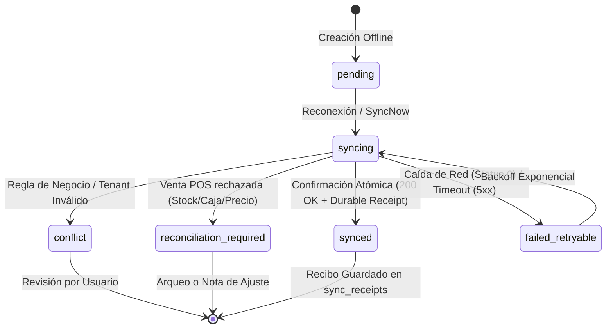

# Arquitectura PWA Offline-First — AuroraStore

**Módulo:** Progressive Web App (PWA) & Sincronización Transaccional  
**Tecnologías:** Angular 21 (Signals, RxJS) · FastAPI · PostgreSQL (Migraciones 003 y 004) · Service Worker Nativo · IndexedDB v4  
**Última Actualización:** 2026-11-07  
**Estado:** 100% Verificado (8/8 Pruebas Automatizadas en `tests/test_pwa_iter2.py`)  

---

## 1. Visión General del Sistema

AuroraStore opera bajo una arquitectura **Offline-First Responsiva**, diseñada para garantizar que clientes y cajeros de boutiques puedan navegar catálogos, gestionar bolsas de compras y preparar operaciones presenciales sin interrupciones por caídas de conectividad.

```
┌──────────────────────────────────────────────────────────────────────────────────┐
│                                CLIENTE NAVEGADOR                                 │
│                                                                                  │
│   ┌───────────────────────────────┐       ┌───────────────────────────────────┐  │
│   │ 1. Service Worker (/sw.js)    │       │ 2. IndexedDB (aurora_store_pwa)   │  │
│   │ • Shell: /, /index.html       │       │ • Particionado por Tenant y User  │  │
│   │ • Bundles JS/CSS con hash     │       │ • 3 Tiendas Durables (Cola Sync)  │  │
│   │ • Imágenes de prendas (LRU)   │       │ • 7 Tiendas de Caché Efímera      │  │
│   │ • EXCLUSIÓN: /api/*, POST, Auth│      │ • Memoria Fallback de Seguridad   │  │
│   └───────────────────────────────┘       └───────────────────────────────────┘  │
│                   ▲                                         ▲                    │
│                   │                                         │                    │
│   ┌───────────────┴─────────────────────────────────────────┴────────────────┐   │
│   │ 3. Servicios Reactivos Angular (Signals + RxJS)                          │   │
│   │ • NetworkStatusService: Telemetría de red + ping pasivo / activo         │   │
│   │ • SyncQueueService: Cola FIFO, backoff exponencial, locks multi-pestaña   │   │
│   │ • PwaUpdateService: Registro, detección de chunks 404, aviso de update   │   │
│   └─────────────────────────────────────┬────────────────────────────────────┘   │
└─────────────────────────────────────────┼────────────────────────────────────────┘
                                          │ POST /api/sync/lote
                                          ▼
┌──────────────────────────────────────────────────────────────────────────────────┐
│                        BACKEND FASTAPI + POSTGRESQL                              │
│   • pg_advisory_xact_lock sobre (schema, id_usuario, id_empresa, operation_id)   │
│   • Huella criptográfica SHA-256 de solicitud y deduplicación con replay         │
│   • Transacción atómica única para efecto de negocio y recibo t_sync_recibo       │
│   • Aislamiento estricto multitenant con exigir_vigencia y RBAC en servidor      │
└──────────────────────────────────────────────────────────────────────────────────┘
```

---

## 2. Niveles de Almacenamiento y Separación Estricta

Para cumplir las reglas de seguridad multitenant y prevenir fugas de información entre usuarios en dispositivos compartidos, el almacenamiento local se divide en dos dominios impermeables:

### A. CacheStorage (Service Worker)
- **`aurora-shell-v2.0.0`:** Archivos esenciales del App Shell (`/`, `/index.html`, `/manifest.webmanifest`, `/favicon.ico`, iconos PWA). Estrategia *Network-First* con entrega de la versión en caché ante fallo de red.
- **`aurora-static-v2.0.0`:** Chunks compilados de JavaScript y hojas de estilo CSS con hash en el nombre. Estrategia *Cache-First* (inmutables por hash de compilación).
- **`aurora-images-v2.0.0`:** Imágenes de prendas y fotos de catálogo. Estrategia *Stale-While-Revalidate* con recorte LRU a un máximo de **120 imágenes** (`trimCache`).
- **Regla Inquebrantable de Seguridad:** El Service Worker **jamás intercepta ni almacena en CacheStorage** ninguna petición a `/api/*`, peticiones WebSocket `/ws/*`, peticiones con cabecera `Authorization` ni métodos HTTP mutantes (`POST`, `PUT`, `DELETE`, `PATCH`).

### B. IndexedDB (`aurora_store_pwa_db` Versión 4)
Base de datos local transaccional particionada mediante claves de alcance (`scope_key`):
- **Alcance Público:** `public|e:{id_empresa}` (Catálogo, filtros, variantes, sucursales y fotos públicas).
- **Alcance Privado:** `u:{id_usuario}|e:{id_empresa}|b:{id_sucursal}` (Borradores de carrito, solicitudes offline, recibos).

#### Tiendas de Datos (Object Stores):
| Nombre de la Tienda | Carácter | KeyPath | Propósito |
| :--- | :--- | :--- | :--- |
| `pending_operations` | **Durable** | `operation_id` | Cola de operaciones registradas localmente en espera de conectividad. |
| `sync_attempts` | **Durable** | `attempt_id` | Registro de intentos de sincronización y respuestas HTTP obtenidas. |
| `sync_receipts` | **Durable** | `operation_id` | Historial de recibos confirmados por el servidor con su huella de confirmación. |
| `products` | Caché | `key` | Páginas de catálogo consultadas (máx. 20 páginas por scope, TTL 24h). |
| `product_details` | Caché | `key` | Fichas técnicas completas visitadas (máx. 60 fichas por scope, TTL 24h). |
| `catalog_filters` | Caché | `key` | Filtros dinámicos de categorías, tallas, colores y temporadas. |
| `branches` | Caché | `key` | Sucursales de la empresa con ubicación y horarios de atención. |
| `stock_snapshots` | Caché | `key` | Disponibilidad conocida con sello de tiempo `fetched_at`. |
| `cart_drafts` | Caché | `key` | Borrador reactivo de la bolsa de compras por tienda. |
| `metadata` | Caché | `key` | Reservas del usuario y metadatos complementarios. |

*Nota de Seguridad:* Al invocar `cerrarSesion()` en `AuthService`, se ejecuta `purgePrivateData()`, purgando de inmediato los datos de usuario (`u:*`) mientras se preserva el catálogo público de la tienda (`public:*`).

---

## 3. Matriz de Operaciones Offline vs Online

Siguiendo el principio de integridad operativa y comercial de AuroraStore:

| Caso de Uso | Permitido Offline | Tratamiento y Reglas |
| :--- | :---: | :--- |
| **Explorar Catálogo (`CU04W`)** | **SÍ** | Renderiza desde `products` en IndexedDB con aviso visual de datos locales. |
| **Búsqueda y Filtros (`CU05W`)** | **SÍ** | Filtra sobre el subconjunto descargado en cliente. |
| **Ficha de Prenda (`CU06W`)** | **SÍ** | Muestra datos cacheados desde `product_details` con sello de antigüedad. |
| **Stock por Sucursal (`CU07W`)** | **SÍ (Informativo)** | Indica fecha y hora del último inventario consultado; advierte que no garantiza reserva física. |
| **Gestión de Bolsa (`CU08W`)** | **SÍ** | Agregar, modificar cantidad y quitar productos se guardan en `cart_drafts` y encolan en `pending_operations`. |
| **Solicitud de Cita (`CU10W`)** | **SÍ (Gratuita)** | Encola `RESERVA_SOLICITUD` con `con_pago=False`. Se valida al reconectar. |
| **Reserva con Pago Anticipado** | **NO** | Requiere pasarela online. La cola rechaza de inmediato con `PAYMENT_REQUIRES_ONLINE`. |
| **Venta Efectivo en POS (`CU24W`)** | **SÍ (Cajero)** | Cajero con sesión abierta puede emitir venta de contado; al reconectar se sincroniza o pasa a `reconciliation_required`. |
| **Confirmar Compra Online (`CU09W`)** | **NO** | La formalización de un pedido online con cobro electrónico exige conexión activa obligatoria. |

---

## 4. Ciclo de Vida de una Operación en la Cola (`SyncQueueService`)

Cada operación registrada fuera de línea recibe un `operation_id` (UUID v4 inmutable) y avanza por el siguiente autómata de estados:



### Estados:
1. **`pending`:** Registrada en IndexedDB esperando conexión.
2. **`syncing`:** Bloqueada temporalmente durante la transferencia HTTP por lotes hacia `POST /api/sync/lote`.
3. **`synced`:** Éxito absoluto. Confirmada en PostgreSQL en la misma transacción del efecto comercial. Se almacena el recibo y se remueve de `pending_operations`.
4. **`conflict`:** Violación de regla de negocio (ej. tienda suspendida, falta de rol, reserva fuera de horario). No se reintenta automáticamente; se expone al usuario.
5. **`reconciliation_required`:** Exclusivo de ventas POS en efectivo (`VENTA_CONTADO`) cuando al reconectar se detecta caja cerrada, precio modificado o falta de stock. **Prohibido eliminar silenciosamente**: se preserva tanto en servidor como en IndexedDB para la conciliación física del cajero.
6. **`failed_retryable`:** Fallo transitorio de red o servidor no disponible. Se reprograma automáticamente mediante backoff exponencial (`next_retry_at_ms`).

---

## 5. Garantías en el Servidor (FastAPI & PostgreSQL)

1. **Bloqueo Transaccional por Aviso (`pg_advisory_xact_lock`):**
   - Se obtiene un lock exclusivo sobre la combinación hash de `(schema, id_usuario, id_empresa, operation_id)`.
   - Garantiza que peticiones concurrentes desde dos pestañas o reintentos de red no ejecuten dos veces la misma operación.
2. **Detección Criptográfica de Replay Idempotente:**
   - Se calcula el `request_hash` (SHA-256) del contenido canónico de la operación.
   - Si la fila en `t_sync_operacion` ya existe y el hash coincide, se retorna el recibo original con `idempotent_replay: true` sin duplicar transacciones de inventario ni ventas.
3. **Atomicidad Absoluta (Sin Commits Parciales):**
   - La inserción de la venta/reserva, el movimiento de inventario (`t_movimiento_inventario`) y el recibo en `t_sync_recibo` se confirman en el mismo y único `COMMIT`.
   - Si una operación falla por validación de negocio, se retrocede al `SAVEPOINT` correspondiente para preservar el recibo de error sin aplicar efectos no deseados.
